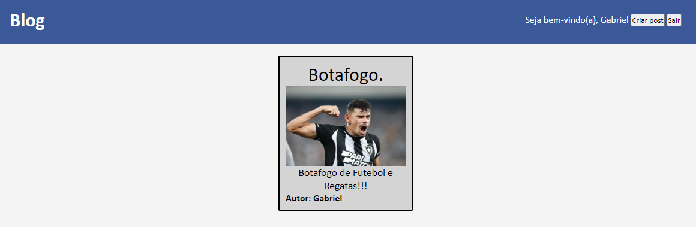
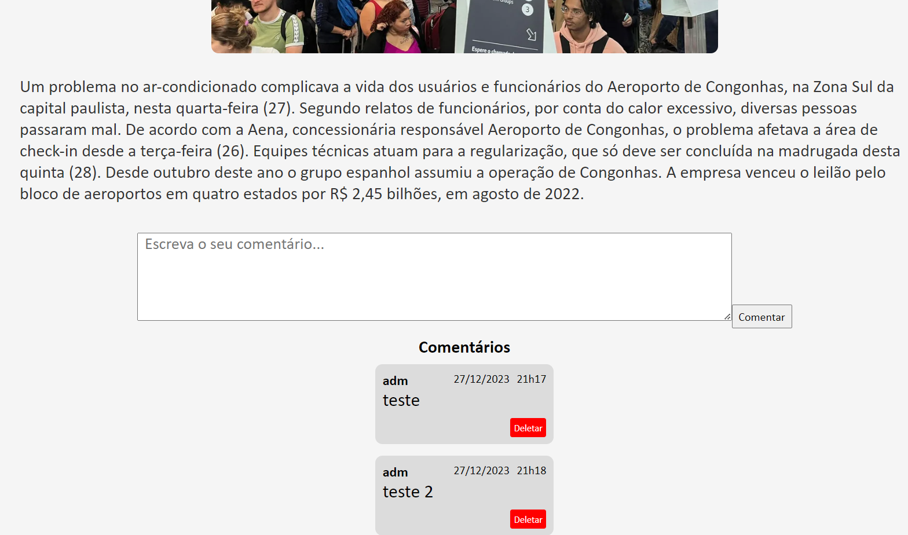
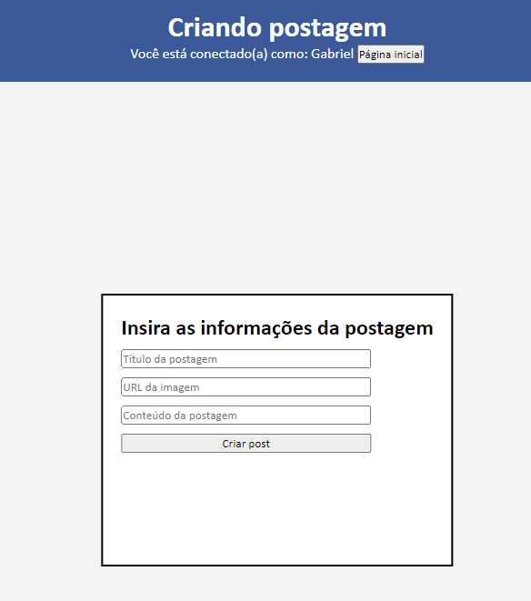
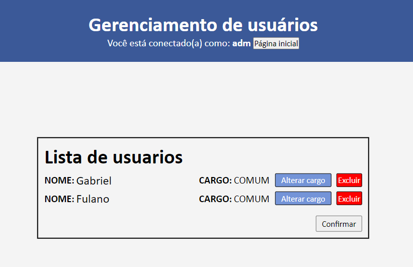
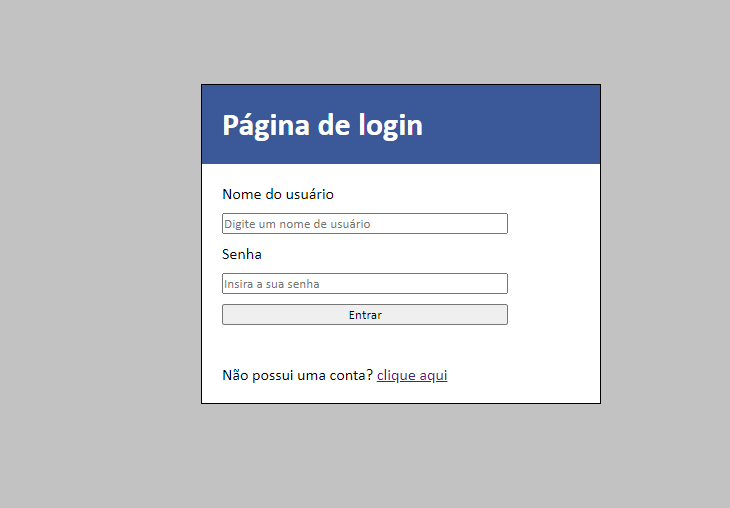

# Blog de Notícias

Projeto fullstack de um blog com sistema de **autenticação** e **autorização baseada em papéis e permissões (RBAC - Role-Based Access Control)**.

A aplicação conta com controle de acesso granular tanto no backend (Spring Security + JWT) quanto no frontend (React com proteção de rotas e renderização condicional baseada em permissões). O sistema permite a publicação e gerenciamento de postagens, moderação de comentários, gerenciamento de usuários/perfis e envio assíncrono de e-mails de boas-vindas utilizando RabbitMQ.

---

## 💡 Contexto do Projeto & Uso de IA

Este projeto teve início em **2023**, sendo construído originalmente do zero e de forma manual para consolidar fundamentos de desenvolvimento Fullstack (Spring Boot, React, RabbitMQ e Docker) — época em que o auxílio de IA para escrita de código ainda não era utilizado no meu fluxo de desenvolvimento.

Com a evolução contínua do projeto e a adição de novas funcionalidades (como o sistema **RBAC** e futuras features planejadas), passei a integrar **assistentes de Inteligência Artificial** no processo de desenvolvimento como ferramenta de apoio para produtividade e pair programming, mantendo total controle técnico sobre a arquitetura, regras de negócio e tomadas de decisão.

---

## 🔐 Controle de Acesso (RBAC)

O sistema implementa uma estrutura desacoplada de controle de acesso:

- **Permissões Granulares (Permissions)**: Ações atômicas do sistema, como:
  - `POST_READ`, `POST_CREATE`, `POST_UPDATE`, `POST_DELETE`
  - `COMMENT_CREATE`, `COMMENT_DELETE`
  - `USER_READ`, `USER_UPDATE`, `USER_DELETE`, `ROLE_MANAGE`
- **Perfis (Roles)**: Agrupamentos de permissões associados aos usuários:
  - `ROLE_ADMIN`: Administrador com acesso total (criação, edição e exclusão de posts, moderação de comentários e gestão de usuários/cargos).
  - `ROLE_COMUM`: Usuário padrão (leitura de posts e interação/criação de comentários).
- **Backend (Spring Security + JWT)**: Validação de tokens JWT carregando as autoridades/permissões do usuário para proteção dos endpoints da API REST.
- **Frontend (React)**: Gerenciamento de estado de autenticação via Context API (`AuthContext`) e componentes de rotas protegidas (`ProtectedRoute`) que liberam telas e ações somente para usuários com as permissões requeridas.

---

## 🛠️ Tecnologias e Ferramentas

- **Backend**:
  - Java & Spring Boot
  - Spring Security (Autenticação Stateless com JWT e RBAC)
  - Spring Data JPA & Hibernate
  - Spring EmailSender
- **Mensageria**:
  - RabbitMQ (processamento assíncrono do envio de e-mails de boas-vindas)
- **Frontend**:
  - ReactJS (Vite)
  - Axios (com interceptors para envio de token JWT)
  - React Router DOM
  - Context API para gerenciamento de permissões e sessão
- **Banco de Dados & Infraestrutura**:
  - PostgreSQL
  - Docker & Docker Compose

---

## 🚀 Como Executar Localmente

### Pré-requisitos
- [Docker](https://www.docker.com/) e Docker Compose instalados
- [Node.js](https://nodejs.org/) (com `npm`) instalado

### Passo a Passo

1. **Clone o repositório**:
   ```bash
   git clone https://github.com/GabeOP/blog-noticias.git
   cd blog-noticias
   ```

2. **Inicie o Backend, Banco de Dados e RabbitMQ com Docker**:
   Na raiz do projeto (onde está o `docker-compose.yml`):
   ```bash
   docker-compose up -d
   ```
   > O backend (`appspring`), o PostgreSQL (`banco_blog` na porta `5433:5432`) e o RabbitMQ (`rabbitmq` na porta `5672` e painel em `15672`) serão inicializados com as variáveis de ambiente já configuradas automaticamente.

3. **Inicie o Frontend**:
   Abra um novo terminal, navegue até a pasta `frontend` e execute:
   ```bash
   cd frontend
   npm install
   npm run dev
   ```

4. **Credenciais Padrão**:
   - Usuário Administrador inicial:
     - **Usuário**: `adm`
     - **Senha**: `123456`

---

## 📸 Imagens do Projeto

<div align="center">
  <h3 align="center">Página Inicial</h3>
  <p>Visualização das postagens existentes no blog. Usuários podem clicar em "Ler mais..." (ou "Gerenciar" no caso de administradores).</p>
  
</div>

<div align="center">
  <h3 align="center">Página do Post</h3>
  <p>Exibição completa da postagem, incluindo título, autor, imagem e conteúdo.</p>
  
</div>

<div align="center">
  <h3 align="center">Página do Post (Comentários)</h3>
  <p>Seção de comentários. O autor do comentário e usuários com permissão administrativa possuem privilégio para exclusão.</p>
  
</div>

<div align="center">
  <h3 align="center">Página de Criação de Postagens</h3>
  <p>Disponível apenas para usuários com permissão de criação de conteúdo (`POST_CREATE`).</p>
  
</div>

<div align="center">
  <h3 align="center">Página de Gerenciamento de Usuários</h3>
  <p>Painel administrativo restrito para alteração de papéis/permissões e exclusão de contas.</p>
  
</div>

<div align="center">
  <h3 align="center">Página de Autenticação</h3>
  <p>Tela de login e registro de novos usuários no sistema.</p>
  
</div>
